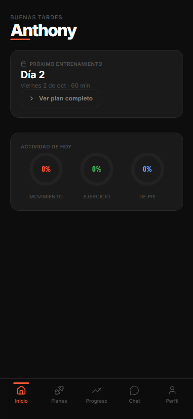
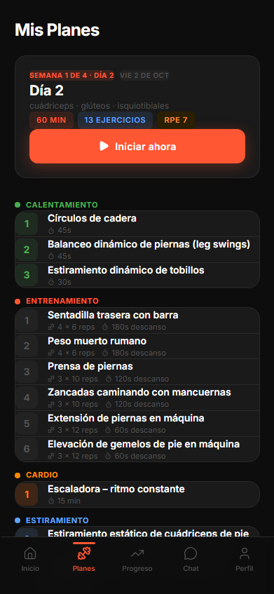
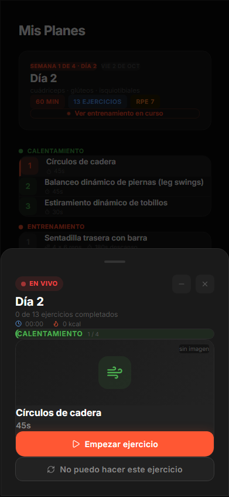
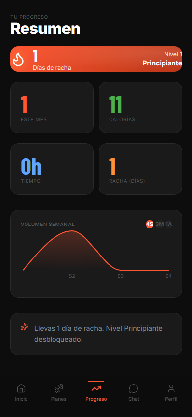
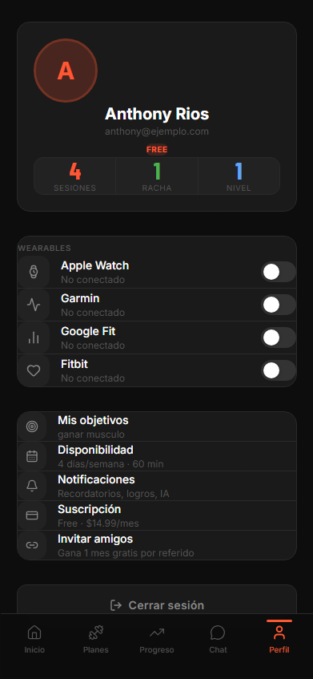

# FitnessAI Connect

[](./LICENSE)


Plataforma de fitness **open source** que conecta entrenadores personales con usuarios mediante entrenamientos personalizados potenciados por IA. Pensada para LATAM (México, Argentina, Colombia): toda la interfaz está en español.

<p align="center">
  
  
  
  
  
</p>

<p align="center"><sub>Inicio · Plan del día · Sesión en vivo · Progreso · Perfil</sub></p>

## Qué hace

- **Plan semanal generado por IA** (Groq · LLaMA 4 Scout) a partir del onboarding: objetivo, días disponibles, minutos por sesión y equipo. Cada sesión se divide en calentamiento, fuerza, cardio y estiramiento, con descansos según el tipo de ejercicio.
- **Sesión en vivo**: cronómetro con hora de reloj que sobrevive a recargas y cambios de dispositivo, registro serie a serie, temporizador de descanso y calorías estimadas por RPE.
- **Sustitución de ejercicios** ("No puedo hacer este ejercicio"): el ranking de alternativas lo calcula una huella biomecánica determinista sobre un catálogo de ~150 ejercicios, no la IA.
- **Progreso**: racha, niveles, métricas del mes y gráfica de volumen semanal (4 semanas, 3 meses, 1 año).
- **Wearables**: Apple Watch, Garmin, Google Fit y Fitbit. Sin wearable, la frecuencia cardiaca se muestra vacía en lugar de simularse.
- **Entrenadores**: chat en tiempo real entrenador ↔ usuario (Supabase Realtime) y panel de entrenador.

---

## Stack

| Capa | Tecnología |
|------|-----------|
| Frontend | React 18 + Vite 5 + Tailwind CSS v4 |
| Backend | Node.js 18+ + Express 4 (ESM) |
| Base de datos | Supabase (PostgreSQL + Auth + Realtime) |
| IA | Groq SDK — LLaMA 4 Scout 17B |
| Gráficas | Recharts · **Animación** Framer Motion · **Iconos** lucide-react |
| Tests | Vitest + Supertest (backend) · Vitest + Testing Library (frontend) |

---

## Requisitos

- Node.js **>= 18** (probado con 24.x)
- Cuenta en [Supabase](https://supabase.com)
- Cuenta en [Groq](https://console.groq.com) (free tier)

---

## Instalación

```bash
npm run install:all
```

Instala las dependencias de la raíz, `backend/` y `frontend/`.

### Base de datos

Ejecutar `database/schema.sql` en el SQL Editor de Supabase. Incluye 11 tablas, 1 vista, RLS, índices, el trigger de auto-creación de perfil y 15 ejercicios de seed en español.

> Si tu base de datos ya existe, ejecuta únicamente el bloque **MIGRACIONES** del final del archivo (es idempotente).

### Variables de entorno

**`backend/.env`** (copiar de `backend/.env.example`)

```env
SUPABASE_URL=https://<proyecto>.supabase.co
SUPABASE_ANON_KEY=<anon_key>
SUPABASE_SERVICE_ROLE_KEY=<service_role_key>
GROQ_API_KEY=<groq_api_key>
PORT=3000
FRONTEND_URL=http://localhost:5173
NODE_ENV=development
# Opcional: zona horaria con la que el backend decide qué es "hoy".
# Por defecto UTC. En producción conviene fijarla al mercado objetivo.
APP_TIMEZONE=America/Mexico_City
```

`SUPABASE_URL` y `SUPABASE_SERVICE_ROLE_KEY` son obligatorias: el servidor no arranca sin ellas. Sin `GROQ_API_KEY` la app funciona, pero los endpoints de IA responden `503`.

`FRONTEND_URL` admite una lista separada por comas para varios orígenes CORS.

**`frontend/.env`** (copiar de `frontend/.env.example`)

```env
VITE_SUPABASE_URL=https://<proyecto>.supabase.co
VITE_SUPABASE_ANON_KEY=<anon_key>
VITE_API_URL=http://localhost:3000/api
```

> `VITE_API_URL` sólo hace falta en producción: en desarrollo el proxy de Vite reenvía `/api/*` a `localhost:3000`.

---

## Ejecutar en local

```bash
npm run dev
```

Levanta backend (`http://localhost:3000`) y frontend (`http://localhost:5173`) a la vez.

Por separado:

```bash
npm run dev --prefix backend
```

```bash
npm run dev --prefix frontend
```

> En Windows, usar `cmd` en lugar de PowerShell si `npm` falla por ExecutionPolicy.

---

## Tests

```bash
npm test
```

| Comando | Qué ejecuta |
|---------|-------------|
| `npm test` | Toda la suite (backend + frontend) |
| `npm run test:backend` | Sólo backend |
| `npm run test:frontend` | Sólo frontend |
| `npm run test:unit` | Lógica pura de ambos lados |
| `npm run test:integration` | Endpoints con Supertest |
| `npm run test:components` | Componentes React |
| `npm run test:coverage` | Toda la suite con cobertura |
| `npm run test:watch` | Modo watch en ambos proyectos |

Los tests no tocan servicios reales: Supabase y Groq se sustituyen por dobles.

Informes de cobertura HTML en `backend/coverage/index.html` y `frontend/coverage/index.html`.

---

## Build

```bash
npm run build
```

Genera `frontend/dist/`. No hay linter ni type-checking configurados en el proyecto.

---

## Arquitectura

```
dorcher/
├── database/
│   └── schema.sql            # Tablas + RLS + índices + migraciones + seeds
├── backend/
│   ├── server.js             # Arranque: carga .env, valida entorno, escucha
│   ├── app.js                # createApp(): CORS, rate limit, rutas, errores
│   ├── config/supabase.js    # Cliente service_role compartido (singleton)
│   ├── middleware/auth.js    # Verificación del JWT de Supabase
│   ├── lib/                  # Lógica pura y testeable
│   │   ├── dates.js          #   fechas ISO, semanas, zona horaria
│   │   ├── streak.js         #   racha y nivel
│   │   ├── progress.js       #   agregados y gráfica semanal
│   │   ├── plan.js           #   prompt, parseo y mapeo del plan IA
│   │   ├── insights.js       #   prompts de insight y tipos de BD
│   │   ├── groq.js           #   cliente Groq con reintentos
│   │   ├── validation.js     #   validadores de entrada
│   │   └── http.js           #   HttpError, asyncHandler
│   ├── routes/               # home, workouts, progress, profile, ai, auth
│   └── tests/                # unit/ + integration/
└── frontend/
    └── src/
        ├── App.jsx           # Navegación por estado + estado global
        ├── index.css         # Design system (Tailwind @theme)
        ├── api/client.js     # Supabase + wrapper HTTP
        ├── hooks/useApiData  # Carga con loading/error/retry
        ├── lib/              # dates.js, workout.js (lógica pura)
        ├── components/       # WorkoutModal, ErrorState
        └── screens/          # Login, Onboarding, Home, Plans, Progress,
                              # Profile, Chat, DashboardCoach, ResetPassword
```

### Flujo de información

1. **Auth** — `supabase.auth` en el cliente emite el JWT. Cada llamada de `api/client.js` pide una sesión fresca e inyecta `Authorization: Bearer <token>`.
2. **Backend** — `middleware/auth.js` valida el token con la clave `service_role` y adjunta `req.user`. Todas las consultas se acotan por `req.user.id`; RLS actúa como segunda barrera para los accesos directos desde el cliente.
3. **Rutas** — cada router valida su entrada (`lib/validation.js`), delega los cálculos en `lib/` y responde JSON. Los errores viajan como `HttpError` hasta el manejador central de `app.js`.
4. **IA** — `POST /ai/generate-plan` construye el prompt en `lib/plan.js`, valida el JSON devuelto **antes** de escribir en base de datos, crea el plan, archiva los anteriores y persiste sesiones y ejercicios.
5. **Realtime** — el chat entrenador ↔ usuario va directo del cliente a Supabase Realtime, sin pasar por el backend.

### Navegación del frontend

No hay React Router: `App.jsx` mantiene `activeScreen` y renderiza la pantalla correspondiente. El onboarding es una compuerta previa (`profile.onboarding_completed`). `Progreso` y el panel de entrenador se cargan con `React.lazy` para no arrastrar Recharts en el bundle inicial.

El `WorkoutModal` permanece montado mientras exista una sesión activa, de modo que minimizarlo no reinicia el cronómetro; una barra "En vivo" permite volver.

---

## API

Todos los endpoints bajo `/api`. ✓ = requiere `Authorization: Bearer <jwt>`.

| Método | Ruta | Auth | Descripción |
|--------|------|:----:|-------------|
| GET | `/health` | — | Estado del servicio (fuera del rate limit) |
| POST | `/api/auth/check-email` | — | ¿El correo está registrado? |
| GET | `/api/home` | ✓ | Dashboard: sesión de hoy o próxima, anillos, HRV, insight, semana |
| GET | `/api/workouts/plan` | ✓ | Plan activo con sesiones y ejercicios |
| GET | `/api/workouts/upcoming` | ✓ | Próximas 5 sesiones pendientes |
| POST | `/api/workouts/sessions/:id/start` | ✓ | Marcar sesión `in_progress` |
| PATCH | `/api/workouts/sessions/:id/complete` | ✓ | Cerrar sesión y recalcular racha |
| PATCH | `/api/workouts/sessions/:sid/exercises/:eid/toggle` | ✓ | Marcar ejercicio completado |
| POST | `/api/workouts/sessions/:sid/exercises/:eid/sets` | ✓ | Registrar una serie (upsert) |
| GET | `/api/progress/stats` | ✓ | Stats del mes + racha + nivel |
| GET | `/api/progress/chart?period=4w\|3m\|1y` | ✓ | Volumen semanal |
| POST | `/api/progress/metrics` | ✓ | Alta/actualización de métricas del día |
| GET | `/api/progress/metrics?days=N` | ✓ | Historial de métricas (1-365 días) |
| GET | `/api/profile` | ✓ | Perfil + wearables + total de sesiones |
| PATCH | `/api/profile` | ✓ | Actualiza sólo campos de la whitelist |
| POST | `/api/profile/wearables` | ✓ | Conectar wearable |
| DELETE | `/api/profile/wearables/:platform` | ✓ | Desconectar wearable |
| POST | `/api/ai/insight` | ✓ | Insight contextual (reintenta ante 429) |
| POST | `/api/ai/generate-plan` | ✓ | Genera el plan de la semana 1 |

**Códigos de error**: `400` entrada inválida · `401` token ausente/caducado · `403` recurso de otro usuario · `404` no existe · `429` rate limit (propio o de Groq) · `502` fallo del proveedor de IA · `503` IA no configurada.

---

## Diseño

Tokens definidos en `frontend/src/index.css` (bloque `@theme` de Tailwind v4):

```css
--color-bg:         #0D0D0D   /* fondo de página */
--color-surface:    #1A1A1A   /* tarjetas y paneles */
--color-surface2:   #222222   /* superficie secundaria */
--color-border:     #2A2A2A   /* bordes sutiles */
--color-accent:     #FF5733   /* naranja — acción principal */
--color-green:      #4CAF50   /* éxito, rachas */
--color-blue:       #60a5fa   /* métricas informativas */
--color-txt:        #FFFFFF   /* texto principal */
--color-txt2:       #888888   /* texto secundario */
--color-txt3:       #555555   /* texto terciario */
--font-body:        'Inter'
--font-metric:      'Barlow Condensed'   /* números grandes */
```

Tema oscuro, tarjetas `#1A1A1A` con borde de 1px, sin sombras. Mobile-first (390×844); por debajo de 460 px el marco de teléfono desaparece y la app ocupa la pantalla completa.

---

## Pendientes

Ver [`COMPONENTES-PENDIENTES.md`](./COMPONENTES-PENDIENTES.md) para el roadmap completo.

---

## Deploy

La app se despliega como **un solo servicio**: Express sirve la API en `/api/*` y el build de la SPA en el resto de rutas. El repo trae `railway.json` listo para Railway:

```bash
npm run build:deploy   # instala backend + frontend y genera frontend/dist
npm start              # Express sirve API + SPA
```

| Servicio | Uso | Free tier |
|----------|-----|-----------|
| Railway | App (API + SPA) | $5 crédito/mes |
| Supabase | DB + Auth + Realtime | 500 MB DB, 50 K MAU |
| Groq | IA LLaMA 4 Scout | 500 K tokens/día |

Guía completa, variables de entorno y alternativa con frontend en CDN en [`DEPLOY.md`](./DEPLOY.md).

---

## Contribuir

Las contribuciones son bienvenidas. Antes de abrir un PR:

1. Lee [`PRODUCT.md`](./PRODUCT.md) (usuarios y principios del producto) y [`DESIGN.md`](./DESIGN.md) (sistema visual) si tu cambio toca la interfaz.
2. Todo cambio de lógica de negocio va con su test. `npm test` debe pasar y respetar los umbrales de cobertura.
3. Los textos de la interfaz y los comentarios del código van en español.
4. Accesibilidad no negociable: botones reales (`<button>`), `aria-*` en toggles y chips, `<label>` en cada input.

Para bugs e ideas, abre un [issue](https://github.com/tonninors/fitnessai-connect/issues). El roadmap pendiente está en [`COMPONENTES-PENDIENTES.md`](./COMPONENTES-PENDIENTES.md).

---

## Licencia

[MIT](./LICENSE). Puedes usar, modificar y distribuir el código libremente, incluso con fines comerciales, manteniendo el aviso de copyright.
